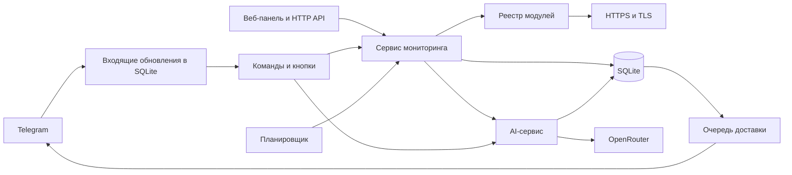

# PulseDesk

**PulseDesk — приватный Telegram-бот и веб-панель для мониторинга публичных сайтов и HTTPS API.** Он проверяет, отвечает ли сервис, осталась ли на странице важная фраза, когда истекает TLS-сертификат и выполняется ли условие, описанное обычным языком. Когда несколько проверок подряд завершаются неудачно, PulseDesk открывает инцидент. Подписчики получают уведомления о сбое и восстановлении, а оператор может отметить, что взял проблему в работу.

С подключённым OpenRouter бот помогает разобрать инцидент, отвечает на вопросы по данным мониторинга, формирует отчёты и предлагает проверки для нового сайта. Основные проверки, журнал инцидентов, уведомления и отчёты по шаблону работают без AI.

**Версия в репозитории** — `0.1.0`. **Стек** — JavaScript, Node.js 24.x, встроенный SQLite, Telegram Bot API и HTML/CSS/JavaScript без сборщика.

- [Быстрый запуск демо](#быстрый-запуск-демо)
- [Подключение Telegram-бота](#подключение-telegram-бота)
- [Типы проверок](#типы-проверок)
- [Работа с панелью](#работа-с-панелью)
- [Команды Telegram](#команды-telegram)
- [Инциденты и уведомления](#инциденты-и-уведомления)
- [AI-ассистент и отчёты](#ai-ассистент-и-отчёты)
- [Конфигурация](#конфигурация)
- [Webhook и развёртывание](#webhook-и-развёртывание)
- [HTTP API](#http-api)
- [Хранение данных](#хранение-данных)
- [Архитектура и расширение](#архитектура-и-расширение)
- [Тестирование](#тестирование)
- [Решение типовых проблем](#решение-типовых-проблем)

## Быстрый запуск демо

Понадобятся **Node.js 24.x**, npm и браузер. В `package.json` зафиксирован npm `11.19.0`. Сторонних npm-зависимостей у PulseDesk нет, поэтому приложение можно запустить из исходников сразу. Все команды ниже выполняются из корня репозитория.

```powershell
node --version
npm run demo
```

Откройте [локальную панель](http://127.0.0.1:4141). Если порт задан в конфигурации, используйте адрес из строки запуска в терминале. Чтобы остановить сервер, нажмите `Ctrl+C`.

### Первый сценарий

1. В разделе **«Обзор»** выберите **«Сайт перестал отвечать»** и нажмите **«Запустить сбой»**. Демонстрационный сайт вернёт `HTTP 503`, а PulseDesk выполнит достаточно измерений для открытия инцидента с учётом настроенного порога.
2. Найдите открытый инцидент в ленте и нажмите **«Беру в работу»**. В карточке появится отметка о подтверждении.
3. Нажмите **«Восстановить»**. Следующая успешная проверка закроет инцидент, а в предпросмотре Telegram появится сообщение о восстановлении.
4. Отправьте `/status` и `/incidents` через поле ввода в предпросмотре. В разделе **«Доставка»** можно увидеть созданные сообщения и число попыток отправки.
5. Откройте **«AI-ассистент»** и нажмите **«Отчёт за 7 дней»**. На чистом запуске без ключа OpenRouter появится отчёт по шаблону.

| Сценарий | Что меняется |
| --- | --- |
| Сайт перестал отвечать | Главная страница возвращает `HTTP 503`. Срабатывает проверка доступности. |
| Пропала форма заявки | Из ответа страницы контактов исчезает фраза `Оставить заявку`. Срабатывает проверка контента. |
| Истекает SSL-сертификат | Тестовый срок сертификата сокращается до пяти дней. Срабатывает TLS-проверка с порогом 14 дней. |
| Сайт отвечает медленно | Время HTTP-ответа увеличивается. Эффект виден на графике. Для задержки отдельного порога инцидента в этой версии нет. |
| Пропали цены (заметит только AI) | Из текста страницы прайса исчезают цены, а кнопка заявки остаётся. Нарушение условия определяет подключённая модель. |

Демо открывается только на локальном интерфейсе. В нём заранее созданы четыре проверки с тестовой историей, сетевые ответы имитируются, а сообщения записываются в предпросмотр. Собственные адреса добавляются в рабочих режимах `polling` и `webhook`. При включённом AI демо отправляет настоящие запросы в OpenRouter на основе тестовых данных. Для показа целиком на локальных данных используйте конфигурацию запуска с `PULSE_AI=off`.

Сценарий и история сохраняются в демонстрационной SQLite-базе, поэтому повторный запуск может открыть панель с состоянием прошлого сеанса. Кнопка **«Восстановить»** переводит включённые тестовые проверки в штатный сценарий.

## Подключение Telegram-бота

Для первого рабочего запуска используйте **`polling`**. В этом режиме PulseDesk сам забирает обновления из Telegram. Панель может оставаться на `127.0.0.1`, а публичный домен для бота не требуется.

1. Создайте отдельного бота через `@BotFather` и получите токен.
2. Подготовьте числовые Telegram ID пользователей, которым нужен доступ. Для нового бота ID отправителя можно взять из `message.from.id` в ответе Telegram `getUpdates` после первого сообщения, пока PulseDesk ещё не запущен и webhook не установлен.
3. Создайте `.env.pulsedesk` на основе шаблона, если рабочего файла ещё нет.

   ```powershell
   if (-not (Test-Path -LiteralPath .env.pulsedesk)) {
       Copy-Item -LiteralPath .env.pulsedesk.example -Destination .env.pulsedesk
   }
   ```

4. Сгенерируйте отдельный ключ администратора для панели и HTTP API.

   ```powershell
   node -e "console.log(require('node:crypto').randomBytes(32).toString('hex'))"
   ```

5. Укажите свои значения в `.env.pulsedesk`. В примере `123456789` — условный ID.

   ```dotenv
   PULSE_MODE=polling
   PULSE_HOST=127.0.0.1
   PULSE_PORT=4141
   PULSE_BOT_TOKEN=<токен Telegram-бота>
   PULSE_ALLOWED_USER_IDS=123456789
   PULSE_ADMIN_API_KEY=<сгенерированный ключ>
   ```

6. Запустите приложение.

   ```powershell
   npm start
   ```

7. Напишите боту `/start` в личном чате. Команда включает подписку на будущие уведомления. Отправьте `/help`, чтобы проверить, что бот принимает команды.
8. Откройте [веб-панель](http://127.0.0.1:4141), нажмите значок ключа в верхней части страницы и введите `PULSE_ADMIN_API_KEY`. Панель хранит ключ в памяти вкладки. После перезагрузки страницы его нужно ввести снова.
9. Добавьте свой публичный HTTPS-адрес в панели или через команду `/web https://example.com/ | Мой сайт`. В ответе бота будет короткий ID. Используйте `/status` для просмотра состояния, а `/check <ID>` — для запуска вне расписания.

В `PULSE_ALLOWED_USER_IDS` можно перечислить несколько ID через запятую или пробел. Все разрешённые пользователи работают с общим списком проверок и инцидентов и могут управлять им через бота. Команды и кнопки принимаются только в личном чате разрешённого пользователя. После изменения списка перезапустите PulseDesk. При запуске он удаляет сохранённые подписки пользователей, которых больше нет в списке.

## Типы проверок

Один сайт можно добавить сразу в несколько модулей. Например, проверка доступности отвечает за HTTP-статус главной страницы, проверка контента — за текст формы заявки, TLS — за сертификат домена, а AI — за наличие опубликованных цен.

| Модуль | Команда | Как определяется результат |
| --- | --- | --- |
| **Доступность** (`http`) | `/web` | Выполняет HTTPS `GET`, фиксирует код и время полного ответа. Коды `2xx` и `3xx` считаются успешными. При `3xx` измеряется исходный URL, переход по `Location` не выполняется. |
| **Контроль контента** (`content`) | `/watch` | Требует `2xx` и точного вхождения фразы в тело ответа с учётом регистра. Длина фразы — до 160 символов. |
| **SSL-сертификат** (`tls`) | `/tls` | Открывает доверенное TLS-соединение с доменом на порту `443` и проверяет срок сертификата. Сбой фиксируется, когда число оставшихся полных дней меньше или равно порогу. Порог по умолчанию — 14 дней. В панели и API можно задать от 1 до 90 дней. |
| **AI-проверка смысла** (`ai-page`) | `/ai` | Требует `2xx` и непустого текста, извлечённого из ответа страницы. Модель оценивает условие длиной от 5 до 300 символов. Если модель недоступна, результат определяется HTTP-ответом и наличием текста. |

### Какие адреса подходят

- Поддерживаются публичные `https://`-адреса на порту `443`. Можно указать путь, например `/health` или `/pricing`. Адрес вводится без логина и пароля, query-параметров и фрагмента `#`.
- Сетевой транспорт проверяет DNS-ответы и подключается к проверенному IP. Локальные, частные и служебные адреса блокируются, включая случаи, когда DNS возвращает одновременно публичный и запрещённый адрес.
- На DNS-поиск отведено до 3 секунд, на HTTPS-запрос или TLS-соединение после поиска — до 7 секунд. Размер HTTP-ответа ограничен 512 КБ.
- `/watch` ищет фразу в полученном теле ответа. `/ai` извлекает текст из HTML. Оба модуля читают серверный ответ без запуска JavaScript страницы. Для контента, который появляется только после загрузки данных браузером, нужен подходящий публичный URL с данными в исходном ответе.
- Для API модуль `/web` проверяет HTTP-доступность. Содержимое JSON можно контролировать по точной фразе через `/watch`. Для проверки конкретного JSON-поля нужен отдельный модуль.

Дубликат определяется сочетанием типа модуля, нормализованного адреса и настроек. Смена названия сама по себе не создаёт новую проверку с теми же параметрами. Для созданной проверки доступны ручной запуск, пауза и возобновление. Интервал сохраняется при её создании.

## Работа с панелью

| Раздел | Что можно сделать |
| --- | --- |
| **Обзор** | Посмотреть текущие статусы, включить фильтр **«С проблемами»**, приостановить или возобновить проверку. Здесь же показаны последние инциденты, доля успешных измерений и среднее время ответа. Большой график строится по первой HTTP-проверке в списке. |
| **Инциденты** | Открыть историю сбоев, увидеть время открытия и восстановления, подтвердить открытый инцидент. Для обработанных AI-инцидентов отображаются вероятная причина, срочность и шаги проверки. |
| **Доставка** | Посмотреть состояние исходящих сообщений и число попыток. Для сообщения со статусом **«Не доставлено»** доступна кнопка **«Повторить доставку»**. |
| **Модули** | Посмотреть доступные типы проверок, назначение каждого модуля и его команду Telegram. |
| **AI-ассистент** | Посмотреть модель, суточные счётчики запросов, токены, стоимость по данным OpenRouter, последние фоновые задачи и последний отчёт. Кнопка в панели запрашивает отчёт за семь дней. |

Чтобы добавить проверку в рабочем режиме, нажмите **«Добавить проверку»**, выберите модуль и заполните форму. Название может содержать до 70 символов. Для контента укажите контрольную фразу, для AI — условие, для TLS при необходимости задайте собственный порог предупреждения.

Панель обновляет данные каждые четыре секунды. Доля успешных проверок вычисляется по выборке последних измерений, которую отдаёт API — до 48 на каждую проверку. Это доля успешных измерений, а не процент времени, в течение которого сервис был доступен. Временные метки интерфейса показываются в `Europe/Kyiv`. Параметр `PULSE_TIMEZONE` управляет расписанием рассылки и форматированием времени на сервере, включая отчёты.

## Команды Telegram

| Команда | Действие |
| --- | --- |
| `/start` | Начать работу и включить подписку. |
| `/help` | Показать справку и примеры. |
| `/status` | Показать состояния, последние сводки и короткие ID проверок. |
| `/incidents` | Показать до пяти открытых инцидентов с кнопками подтверждения. |
| `/web https://example.com/ \| Сайт` | Добавить проверку доступности. |
| `/watch https://example.com/ \| Example Domain \| Текст главной` | Добавить контроль точной фразы в теле ответа. |
| `/tls https://example.com/ \| Сертификат` | Добавить TLS-проверку с порогом 14 дней. |
| `/ai https://example.com/pricing \| Указаны цены в рублях и есть способ оставить заявку \| Прайс` | Добавить проверку смысла страницы. Замените адрес на свой URL прайса. |
| `/check <ID>` | Запустить включённую проверку сразу и получить обновлённый статус. |
| `/pause <ID>` | Приостановить будущие проверки по расписанию. |
| `/resume <ID>` | Возобновить проверку. Она снова становится доступна планировщику. |
| `/subscribe` | Включить уведомления. |
| `/unsubscribe` | Отключить подписку на инциденты и рассылки. Команды по-прежнему доступны разрешённому пользователю. |
| `/ask Что сегодня падало?` | Задать вопрос модели по текущим данным PulseDesk. |
| `/scan https://example.com/` | Попросить модель предложить проверки для страницы. |
| `/report [дней]` | Запросить отчёт за 1–30 дней. Без аргумента используется 7 дней. |

Разделитель аргументов в командах создания — `|`. Последний аргумент с названием можно опустить, тогда используется стандартное название модуля. Для действий с существующей проверкой подходит полный ID или уникальный префикс от шести символов. Обычно достаточно скопировать восемь символов из `/status`.

Ручная команда `/check` доступна одному чату не чаще раза в 10 секунд. `/ask`, `/scan` и `/report` делят интервал в 15 секунд на чат. Ассистент обрабатывает `/ask`, `/scan` и `/report` в фоне, поэтому бот сначала подтверждает приём команды, а результат отправляет отдельным сообщением.

## Инциденты и уведомления

1. **Измерение.** Планировщик запускает включённые проверки, у которых наступил срок. За один проход он берёт до трёх проверок, начиная с наиболее просроченных, и выполняет их последовательно. Поэтому заданный интервал — целевой. Фактическое время следующей проверки зависит от загрузки и длительности ответов.
2. **Подтверждение сбоя.** По умолчанию нужны два отрицательных результата подряд для одной проверки. Первое неудачное измерение уже сохраняется и может быть видно в фильтре **«С проблемами»**. Количество необходимых подряд сбоев задаётся через `PULSE_FAILURE_THRESHOLD`.
3. **Открытие инцидента.** При достижении порога измерение, состояние проверки, инцидент и уведомления подписчикам записываются одной транзакцией SQLite. Пока инцидент открыт, следующие отрицательные измерения пополняют историю того же сбоя.
4. **Подтверждение оператором.** Кнопка **«Беру в работу»** сохраняет время и автора подтверждения. Инцидент остаётся открытым до успешной проверки. Пауза проверки также оставляет открытый инцидент в истории и приостанавливает дальнейшие плановые измерения.
5. **Восстановление.** Первое успешное измерение сбрасывает счётчик неудач и закрывает открытый инцидент. Подписчики получают отдельное сообщение с длительностью от открытия до восстановления.

Уведомления хранятся в исходящей очереди SQLite. При ошибке отправки PulseDesk повторяет попытку с задержкой и учитывает `retry_after`, если его вернул Telegram. После пяти неудачных попыток сообщение получает состояние `dead`. Ручной повтор возвращает его в очередь и обнуляет счётчик попыток.

Статус **«Telegram принял»** означает успешный ответ Telegram API. При остановке процесса между успешной отправкой и записью результата в SQLite сообщение может быть отправлено повторно. Для событий открытия и восстановления запись очереди дедуплицируется по инциденту, типу события и получателю.

## AI-ассистент и отчёты

### Подключение

Добавьте ключ OpenRouter в `.env.pulsedesk` и перезапустите PulseDesk.

```dotenv
PULSE_AI=auto
PULSE_OPENROUTER_API_KEY=<ключ OpenRouter с префиксом sk-or->
PULSE_AI_MODEL=openai/gpt-6.1-sol
PULSE_AI_REASONING=low
PULSE_AI_DAILY_LIMIT=150
```

Указанная модель — значение по умолчанию в коде. Для проверки страниц, разбора инцидентов и подбора проверок приложение запрашивает структурированный ответ по JSON Schema. При выборе другой модели учитывайте поддержку этого формата и выбранного параметра рассуждения. `PULSE_AI=off` отключает вызовы модели. Расписание отчётов управляется отдельно.

### Что делает модель

| Функция | Данные и результат |
| --- | --- |
| **Разбор инцидента** | После открытия инцидента создаётся фоновая задача. Модель получает параметры проверки, последние измерения и доступный фрагмент ответа сайта. Вероятная причина, оценка срочности и шаги диагностики сохраняются в карточке и отправляются подписчикам отдельным сообщением. Причина — гипотеза на основе измерений PulseDesk. |
| **Проверка смысла** | `/ai` проверяет условие вроде «на странице указаны цены в рублях и есть способ оставить заявку». В OpenRouter передаётся извлечённый текст страницы длиной до 6000 символов. |
| **Вопросы о мониторинге** | `/ask` получает снимок настроенных проверок, недавних измерений, инцидентов и недельной статистики. Например, можно спросить, что сейчас в сбое и какие измерения указывают на проблему. |
| **Подбор проверок** | `/scan` читает указанный адрес и возвращает до пяти предложений, прошедших проверку настроек. В рабочем Telegram-чате кнопка **«＋»** добавляет выбранную проверку. |
| **Отчёты** | PulseDesk собирает число измерений, долю успешных проверок, задержки и инциденты. При доступной модели она формулирует сводку. При выключенном AI, исчерпанном лимите или ошибке модели используется отчёт по шаблону. |

AI-проверка кеширует вердикт по идентификатору проверки, условию и извлечённому тексту. Если текст изменился раньше, чем прошёл `PULSE_AI_PAGE_RECHECK_MINUTES`, модуль может временно использовать предыдущий вердикт. В рабочем режиме по умолчанию это 15 минут. Значение `0` убирает паузу для изменившегося текста, сохраняя повторное использование результата для уже известного текста.

При недоступной модели ответ `2xx` с непустым текстом считается успешным измерением. В сводке указано, что смысл не проверялся. Такой результат может закрыть ранее открытый AI-инцидент, поэтому подтверждение восстановления содержания следует читать по сводке модуля. Ошибка сети, ответ вне `2xx` или пустой извлечённый текст по-прежнему дают отрицательное измерение.

### Расходы и данные

- PulseDesk считает успешно полученные ответы модели по дням UTC. В панели отображаются число учтённых запросов, токены, стоимость из ответа OpenRouter и пропуски по лимиту. Это лимит по числу ответов, а не денежный бюджет.
- После использования примерно 80% суточного лимита вопросы, подбор проверок и AI-сводки перестают расходовать запросы. Разборы инцидентов и проверка смысла могут использовать остаток.
- Разборы, вопросы, подбор и отчёты хранятся в отдельной очереди SQLite. Временные ошибки могут привести к повтору задачи, всего предусмотрено до трёх попыток. Вердикт `ai-page` запрашивается внутри самой проверки.
- В зависимости от функции OpenRouter получает текст или фрагмент проверяемой страницы, адреса и названия проверок, измерения и сводки, условие проверки либо текст вопроса. Ключ OpenRouter передаётся в заголовке авторизации. Telegram-токен, ключ панели и файл базы в запрос модели не включаются.

### Расписание отчётов

```dotenv
PULSE_DIGEST=weekly
PULSE_DIGEST_HOUR=9
PULSE_TIMEZONE=Europe/Kyiv
```

`daily` отправляет суточный отчёт каждый день, `weekly` — недельный по понедельникам, `off` оставляет ручные запросы. Время рассылки определяется по `PULSE_TIMEZONE`. Отчёты по расписанию получают подписчики, в том числе при выключенном AI. На новой базе приложение сначала запоминает текущий интервал расписания, а первая рассылка ставится в очередь при переходе к следующему интервалу. В демо автоматической рассылки нет.

Отчёт опирается на дневные агрегаты измерений, поэтому история в отчёте глубже, чем график в панели. Агрегаты хранятся по календарным дням UTC. Границы периода в отчёте округляются до доступных дневных корзин, а минуты простоя считаются по длительности зарегистрированных инцидентов. Эти числа подходят для эксплуатационной сводки, а для точного расчёта SLA нужна отдельная методика.

## Конфигурация

Рабочая точка входа `index.js` загружает `.env.pulsedesk` из корня приложения и читает параметры `PULSE_*` из окружения процесса. Шаблон — [`.env.pulsedesk.example`](.env.pulsedesk.example). Прежний `.env` относится к архивному Bot_API. После изменения конфигурации перезапустите процесс.

### Сервер и мониторинг

| Переменная | По умолчанию | Назначение |
| --- | --- | --- |
| `PULSE_MODE` | `demo` | `demo`, `polling` или `webhook`. `npm run demo` принудительно выбирает `demo`. |
| `PULSE_HOST` | `127.0.0.1` | Интерфейс HTTP-сервера. Для демо доступны `127.0.0.1`, `localhost` и `::1`. |
| `PULSE_PORT` | `4141` | Порт HTTP-сервера. `0` отдаёт выбор свободного порта операционной системе. |
| `PULSE_DATABASE` | `data/pulsedesk-live.sqlite` | Файл SQLite в рабочих режимах. Относительный путь считается от корня приложения. |
| `PULSE_DEMO_DATABASE` | `data/pulsedesk-demo.sqlite` | Отдельный файл SQLite для демо. |
| `PULSE_INTERVAL_SECONDS` | `60` | Целевой интервал новых рабочих проверок, от 30 до 86 400 секунд. У встроенных демо-проверок свои интервалы. |
| `PULSE_FAILURE_THRESHOLD` | `2` | Последовательные неудачные измерения для открытия инцидента, от 1 до 10. |
| `PULSE_MAX_MONITORS` | `30` | Лимит общего числа добавленных проверок, включая приостановленные. Допустимо от 1 до 100. |

### Доступ

| Переменная | Когда нужна | Назначение |
| --- | --- | --- |
| `PULSE_BOT_TOKEN` | `polling`, `webhook` | Токен из `@BotFather`. |
| `PULSE_ALLOWED_USER_IDS` | `polling`, `webhook` | Непустой список числовых Telegram ID. |
| `PULSE_ADMIN_API_KEY` | `polling`, `webhook` | Случайный ключ от 32 символов для панели и заголовка `X-API-Key`. |
| `PULSE_PUBLIC_ORIGIN` | `webhook` и рабочий запуск на внешнем интерфейсе | Внешний HTTPS-origin без пути и завершающего `/`. |
| `PULSE_WEBHOOK_SECRET` | `webhook` | Отдельный секрет для входящих обновлений Telegram. Допустимы 32–256 букв латиницы, цифр, `_` и `-`. |

### AI и отчёты

| Переменная | По умолчанию | Назначение |
| --- | --- | --- |
| `PULSE_AI` | `auto` | `auto` включает AI при наличии ключа. `off` выключает модель. |
| `PULSE_OPENROUTER_API_KEY` | Пусто | Ключ OpenRouter с префиксом `sk-or-`. |
| `PULSE_AI_MODEL` | `openai/gpt-6.1-sol` | Идентификатор модели в формате `провайдер/модель`. |
| `PULSE_AI_BASE_URL` | `https://openrouter.ai/api/v1` | Базовый HTTPS-адрес AI API. Приложение добавляет `/chat/completions`. На указанный адрес отправляется ключ авторизации. |
| `PULSE_AI_REASONING` | `low` | `none`, `minimal`, `low`, `medium` или `high`. При `none` параметр рассуждения опускается. |
| `PULSE_AI_TIMEOUT_MS` | `45000` | Таймаут вызова модели, от 5000 до 120 000 мс. |
| `PULSE_AI_MAX_OUTPUT_TOKENS` | `1200` | Лимит токенов ответа, от 200 до 8000. |
| `PULSE_AI_DAILY_LIMIT` | `150` | Суточный лимит учтённых ответов, от 1 до 5000. |
| `PULSE_AI_PAGE_RECHECK_MINUTES` | `15` в рабочем режиме, `0` в демо | Пауза перед новым вердиктом при изменении текста, от 0 до 1440 минут. Значение в файле конфигурации переопределяет настройку режима. |
| `PULSE_DIGEST` | `weekly` в рабочем режиме | `off`, `daily`, `weekly`. Для демо расписание всегда выключено. |
| `PULSE_DIGEST_HOUR` | `9` | Час локального времени, от 0 до 23. |
| `PULSE_TIMEZONE` | `Europe/Kyiv` | Часовой пояс IANA для серверного расписания и форматирования времени. |

## Webhook и развёртывание

| Режим | Как поступают обновления Telegram | Типичный запуск |
| --- | --- | --- |
| `demo` | Команды из браузера поступают напрямую в тот же обработчик, который использует бот. Отправка имитируется. | Локальный показ, знакомство с панелью и проверка сценариев. |
| `polling` | Приложение вызывает `getUpdates`. При запуске оно удаляет ранее настроенный webhook без сброса ожидающих обновлений. | Приватный бот на компьютере или сервере с исходящим доступом к Telegram. |
| `webhook` | Telegram отправляет обновления на HTTPS-адрес, который PulseDesk регистрирует при запуске. | Сервер с доступным извне доменом, HTTPS и обратным прокси. |

Для `webhook` заполните параметры рабочего режима и задайте публичный адрес и отдельный секрет.

```dotenv
PULSE_MODE=webhook
PULSE_HOST=127.0.0.1
PULSE_PORT=4141
PULSE_PUBLIC_ORIGIN=https://pulse.example.com
PULSE_WEBHOOK_SECRET=<отдельный случайный секрет>
```

Настройте обратный прокси так, чтобы HTTPS-запросы к `https://pulse.example.com/telegram/webhook` доходили до Node.js по `http://127.0.0.1:4141/telegram/webhook`, включая исходный заголовок `X-Telegram-Bot-Api-Secret-Token`. Внешнюю веб-панель, если она нужна, обслуживайте на том же origin. HTTP-сервер PulseDesk слушает обычный HTTP, сертификат внешнего домена устанавливается на прокси.

При старте PulseDesk сам вызывает `setWebhook`. Входящее обновление сохраняется в SQLite **до** ответа `200`, а повторный `update_id` не создаёт новую запись. Команды и кнопки обрабатываются фоновым циклом после приёма обновления. Для одного токена используйте один активный экземпляр получателя обновлений.

Приложение рассчитано на один экземпляр процесса на рабочую базу и одно общее рабочее пространство. Храните рабочую SQLite-базу на постоянном диске, доступном процессу на запись. `GET /health` возвращает `200`, если фоновый проход завершился недавно и процесс не зафиксировал фоновую ошибку. При запуске, устаревшем проходе или фоновой ошибке возвращается `503`. Для проверки живой Telegram-доставки отдельно выполните `/start` и `/status` в разрешённом личном чате.

## HTTP API

Панель использует те же маршруты, которые можно вызывать из интеграций. В рабочих режимах `GET /api/overview` и команды `POST /api/*` требуют `X-API-Key`. `GET /health`, `GET /api/modules` и статические файлы панели доступны без этого ключа. Webhook защищён собственным секретом.

### Рабочие маршруты

| Метод и путь | Запрос | Результат |
| --- | --- | --- |
| `GET /health` | Без тела | `200` или `503`. Поля `ok`, `product`, `mode`, `lastTick`. |
| `GET /api/modules` | Без тела | `200`. Список модулей, их команды, поля формы и текущий режим. |
| `GET /api/overview` | `X-API-Key` | `200`. Проверки с историей, инциденты, последние доставки, метрики и состояние AI. |
| `POST /api/monitors` | `{ "kind": "...", "name": "...", "target": "...", "config": {} }` | `201`. Создаёт рабочую проверку и возвращает её полный ID в `monitor.id`. |
| `POST /api/monitors/{id}/run` | `{}` | `200`. Запускает включённую проверку сейчас. Результат измерения читается в `/api/overview`. |
| `POST /api/monitors/{id}/pause` | `{}` | `200`. Ставит проверку на паузу. |
| `POST /api/monitors/{id}/resume` | `{}` | `200`. Возвращает проверку в расписание. |
| `POST /api/incidents/{id}/ack` | `{}` | `200` при первом подтверждении открытого инцидента. `409`, если подтвердить его уже нельзя. |
| `POST /api/deliveries/{id}/retry` | `{}` | `200` при возврате сообщения `dead` в очередь. Для остальных состояний — `409`. |
| `POST /api/ai/report` | `{ "days": 7 }` | `202`. Ставит отчёт за 1–30 дней в очередь. Готовый отчёт доступен в `ai.lastReport` ответа `/api/overview`. В демо он также появляется в предпросмотре Telegram. |
| `POST /telegram/webhook` | Обновление Telegram с числовым `update_id` | `200` после сохранения или при повторном `update_id`. Только для `webhook`, с заголовком `X-Telegram-Bot-Api-Secret-Token`. |

В API используйте полный ID из `/api/overview`. Для POST требуется `Content-Type: application/json` и JSON-объект размером до 16 КБ. Типовые ответы при ошибках — `400` для неверных данных, `401` для неверного ключа, `403` для запрещённого origin, `413` для слишком большого тела, `415` для неверного типа содержимого и `429` при превышении частоты команд.

Значение `config` зависит от модуля.

| `kind` | Пример `config` |
| --- | --- |
| `http` | `{}` |
| `content` | `{ "text": "Оставить заявку" }` |
| `tls` | `{ "warningDays": 21 }` |
| `ai-page` | `{ "expectation": "На странице указаны цены в рублях" }` |

### Пример добавления проверки через PowerShell

Выполняйте при запущенном PulseDesk в режиме `polling` или `webhook`. Команда создаёт проверку в рабочей базе.

```powershell
$pulseUrl = 'http://127.0.0.1:4141'
$pulseHeaders = @{
    'X-API-Key' = (Read-Host 'Ключ администратора PulseDesk')
}

$pulseMonitor = @{
    kind = 'content'
    name = 'Текст главной страницы'
    target = 'https://example.com/'
    config = @{
        text = 'Example Domain'
    }
} | ConvertTo-Json -Depth 4

$pulseCreated = Invoke-RestMethod `
    -Method Post `
    -Uri "$pulseUrl/api/monitors" `
    -Headers $pulseHeaders `
    -ContentType 'application/json' `
    -Body $pulseMonitor

$pulseCreated.monitor.id

$pulseOverview = Invoke-RestMethod `
    -Uri "$pulseUrl/api/overview" `
    -Headers $pulseHeaders

$pulseOverview.monitors | Select-Object id, name, status, summary
```

### Маршруты демо

- `POST /api/demo/scenario` принимает `{"scenario":"outage"}`. Допустимые сценарии — `healthy`, `outage`, `content`, `certificate`, `slow`, `semantic`.
- `POST /api/demo/command` принимает `{"text":"/status"}` и запускает команду от демонстрационного пользователя.
- Для POST-запросов демо ожидаются локальный `Origin`, совпадающий с origin панели, и заголовок `X-PulseDesk: dashboard`. Браузерная панель передаёт их при работе с демо.

## Хранение данных

SQLite автоматически инициализируется при запуске и работает в режиме WAL. База содержит конфигурации проверок, измерения, инциденты, подписки, входящие обновления Telegram, исходящие сообщения, очередь AI и её результаты. Демо и рабочий режим по умолчанию используют разные файлы.

| Данные | Что хранится и показывается |
| --- | --- |
| Измерения | До 720 последних записей на проверку в SQLite. `/api/overview` возвращает до 48 записей на проверку. |
| Инциденты | Открытые инциденты и история восстановлений. Обзор отдаёт до 60 карточек, сначала открытые. Закрытые инциденты старше 30 дней удаляются при обслуживании базы. |
| Доставка | Панель показывает до 30 последних записей. Отправленные и отменённые записи старше 30 дней очищаются. Сообщения `dead` могут сохраняться для ручного повтора. |
| Отчётность и расход AI | Дневные агрегаты измерений и использования модели хранятся около 120 дней. |
| AI-задачи и кэш | Панель показывает 12 последних задач. Завершённые, пропущенные и окончательно неудачные задачи, а также старые записи кэша очищаются по 30-дневному порогу. |

Блокировка SQLite (`lease`) ограничивает базу одним обслуживающим фоновым процессом. PulseDesk регулярно продлевает блокировку и освобождает её при штатной остановке. После аварийного выхода она может оставаться действительной до 60 секунд.

Для резервного копирования работающей базы используйте способ создания согласованного SQLite-снимка с учётом WAL. Простой вариант для локального экземпляра — штатно остановить PulseDesk и скопировать файл базы после закрытия процесса. Плановое резервное копирование в приложение не встроено.

## Архитектура и расширение



| Путь | Назначение |
| --- | --- |
| `index.js` | Загрузка конфигурации, запуск сервера, обработка остановки. |
| `src/config.cjs`, `src/app.cjs` | Валидация окружения и сборка приложения из компонентов. |
| `src/core/` | SQLite, планировщик, измерения, инциденты, очередь доставки и правила сетевого доступа. |
| `src/modules/` | Четыре модуля проверок и их регистрация. |
| `src/bot/router.cjs`, `src/adapters/telegram.cjs` | Команды, кнопки, Telegram-транспорт и имитация отправки для демо. |
| `src/http/server.cjs`, `public/` | HTTP API и адаптивная веб-панель. |
| `src/ai/` | Клиент OpenRouter, подготовка данных, запросы модели, кэш, очередь и отчётность. |
| `src/demo/` | Тестовые проверки, начальная история и сценарии. |
| `scripts/`, `test/` | Проверка синтаксиса, сценарные тесты и отдельный AI smoke-прогон. |
| `legacy/` | Архив прежнего HTTP-шлюза Bot_API. Его точка входа отделена от запуска PulseDesk. |

### Добавление своего типа проверки

Модуль реализуется серверным кодом и регистрируется в `src/modules/index.cjs`. Реестр передаёт описание и поля в панель, а обработчик бота находит зарегистрированную Telegram-команду по метаданным модуля.

| Часть модуля | Контракт |
| --- | --- |
| `id`, `title`, `description`, `icon` | Идентификатор и описание для реестра, API и интерфейса. |
| `fields` | Описание полей формы. Типовые свойства — `key`, `label`, `placeholder`, `required`, `type`. |
| `command`, `fromCommand(args)` | Команда Telegram и разбор аргументов в объект `{ name, target, config }`. |
| `validate(input)` | Проверка и нормализация конфигурации в `{ target, config }` без сетевого обращения. |
| `check(monitor, context)` | Асинхронная проверка. Возвращает `healthy` и `summary`, при наличии — `latencyMs`, `meta` и `evidence`. |

Для сетевого чтения модуль получает `context.transport`, для времени — `context.now()`, для остановки внешней операции — `context.signal`. Ошибка проверки преобразуется в отрицательное измерение. Отмена при штатной остановке процесса обрабатывается отдельно. Логику расписания, записи измерений, инцидентов и доставки предоставляет ядро. [Архитектура и пример модуля JSON health-check](docs/ARCHITECTURE.md)

## Тестирование

```powershell
npm run check
npm test
npm run verify
```

- `npm run check` проверяет синтаксис JavaScript рабочего приложения, интерфейса, скриптов и тестов.
- `npm test` запускает встроенный Node Test Runner. Тесты используют временные базы и тестовые адаптеры. Они покрывают инциденты, сохранение и повторы уведомлений, ограничения адресов, маршруты HTTP, команды и кнопки, AI-кэш, лимиты и шаблонные отчёты.
- `npm run verify` выполняет обе проверки последовательно.
- `npm run dev` запускает приложение с перезапуском Node при изменении исходников. Режим выбирается по рабочей конфигурации.

Для отдельной проверки с настоящим OpenRouter доступна команда ниже. Она использует тестовые страницы, базу в памяти и активный ключ OpenRouter. Запросы могут тарифицироваться. Результат сохраняется в `artifacts/local/ai-smoke.json`. При разборе прогона проверьте содержимое ответов и сводку расхода, поскольку вывод `ok` для шага сам по себе не подтверждает правильность ответа модели.

```powershell
npm run ai:smoke
```

В историческом отчёте от 3 ноября 2026 года описаны локальные браузерные сценарии, тесты ранней версии и отдельная проверка настоящего HTTPS/TLS-транспорта. Живая приёмка Telegram-доставки, inline-кнопок и внешнего HTTPS-прокси в этом отчёте не подтверждена. [Отчёт о проверке](docs/VALIDATION_2026-11-03.md)

## Решение типовых проблем

| Симптом | Что проверить |
| --- | --- |
| `npm start` открывает демо | Проверьте `PULSE_MODE` и имя файла `.env.pulsedesk`. Для рабочего бота используйте `npm start`, поскольку `npm run demo` выбирает демо принудительно. |
| Процесс сообщает, что порт занят | Проверьте, запущен ли уже экземпляр PulseDesk. Для отдельного запуска задайте свободный `PULSE_PORT` и откройте адрес из терминала. |
| Процесс сообщает, что база уже обслуживается | Проверьте, какой экземпляр использует файл базы. После аварийного завершения дождитесь истечения блокировки, до 60 секунд. |
| Панель открывается, но не показывает данные | В рабочем режиме повторно введите `PULSE_ADMIN_API_KEY` через значок ключа. Если панель работает через HTTPS-прокси, откройте её на адресе, совпадающем с `PULSE_PUBLIC_ORIGIN`. |
| Кнопки демо возвращают `403` | Откройте панель с локального адреса, который выведен при запуске. Проверьте, не остался ли в конфигурации `PULSE_PUBLIC_ORIGIN` от рабочего webhook. |
| Бот молчит | Проверьте режим, токен, доступ к Telegram и свой числовой ID в `PULSE_ALLOWED_USER_IDS`. Отправьте `/start` в личном чате. Для webhook проверьте публичный HTTPS-маршрут и передачу секретного заголовка. |
| Уведомление не пришло | Проверьте наличие подписки, достижение порога неудачных измерений и запись в разделе **«Доставка»**. Для сообщения `dead` используйте ручной повтор после устранения причины ошибки. |
| `/web` показывает успех, а `/watch` фиксирует сбой | Проверьте исходный код ответа и его HTTP-статус. `/web` принимает `3xx`, а `/watch` требует `2xx` и точного вхождения фразы. Если сервер перенаправляет, укажите конечный публичный HTTPS-адрес. |
| `/ask` или `/scan` не даёт результата | Проверьте, включён ли AI, действителен ли ключ, есть ли доступный лимит и баланс. Состояние фоновой задачи видно в разделе **«AI-ассистент»**. |
| AI-проверка не заметила изменение сразу | Посмотрите сводку проверки, значение `PULSE_AI_PAGE_RECHECK_MINUTES` и первые 6000 символов извлечённого текста. После ошибки модели результат может опираться только на HTTP и наличие текста. |
| `/health` возвращает `503` | При запуске дождитесь завершения первого фонового прохода. Если ответ сохраняется, проверьте длительность проверок и фоновой обработки. Порог свежести последнего прохода — 45 секунд. |

## Материалы проекта

- [Архитектура и контракт модулей](docs/ARCHITECTURE.md)
- [Сценарий показа и описание портфолио-кейса](docs/PORTFOLIO_CASE.md)
- [Исторический отчёт о проверке](docs/VALIDATION_2026-11-03.md)
- [Аудит исходного Bot_API и переход к PulseDesk](docs/AUDIT_2026-11-03.md)
- [Архивный обзор панели](artifacts/screenshots/pulsedesk-incident.jpg) и [мобильный снимок](artifacts/screenshots/pulsedesk-mobile.jpg). Снимки сделаны до добавления четвёртой AI-проверки.

В `package.json` указана лицензия **ISC**.